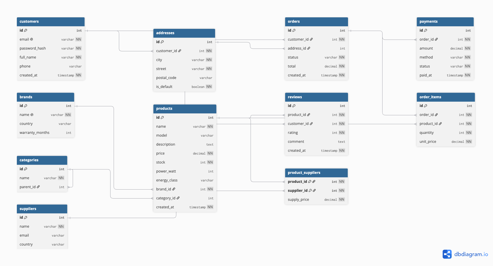
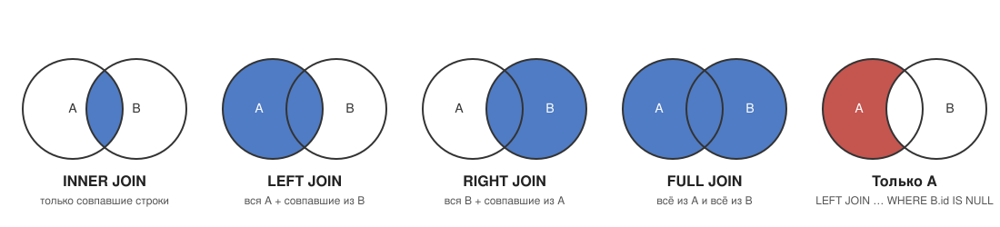
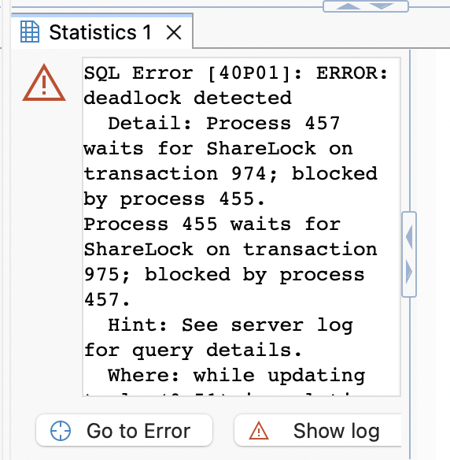
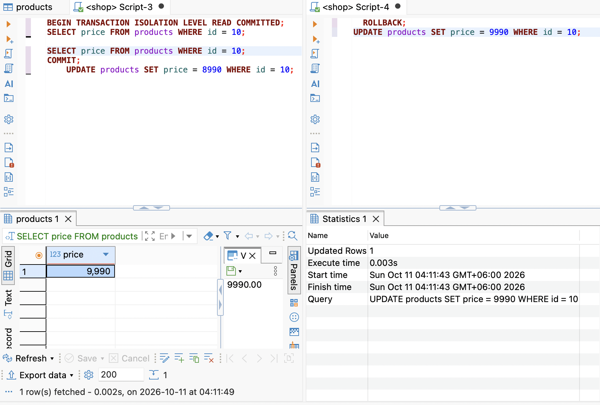
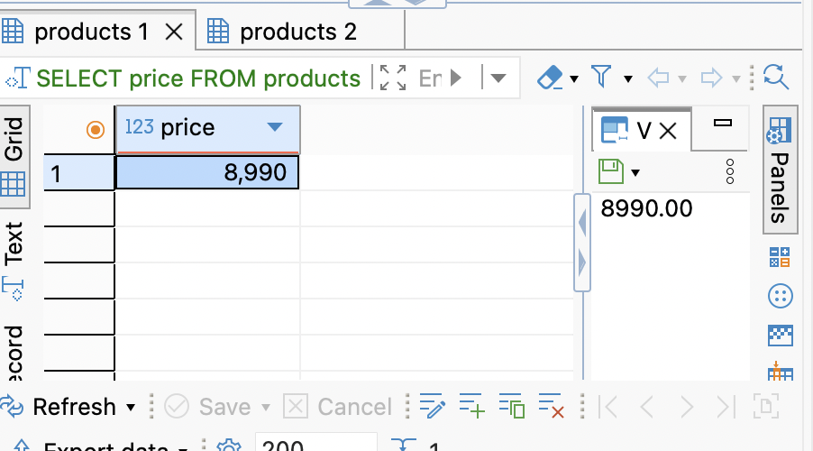
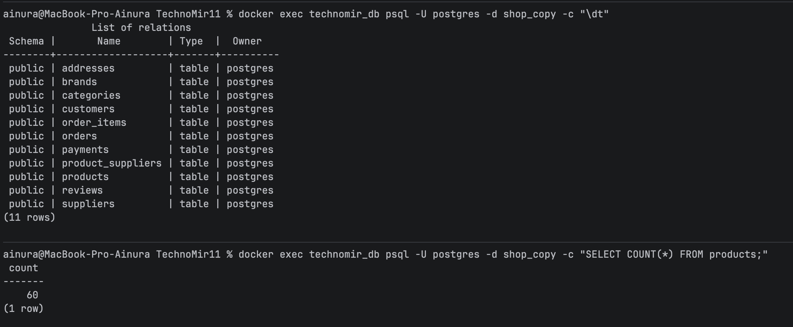

# TechnoMir

Учебная база данных интернет-магазина бытовой техники «ТехноМир» (PostgreSQL 16).

## Структура проекта

- `initdb/` — инициализация БД (Docker выполняет файлы по порядку при создании тома)
  - `01-schema.sql` — схема БД (источник правды)
  - `02-data.sql` — тестовые данные
- `schema.sql` — копия `initdb/01-schema.sql` для сдачи
- `queries.sql` — запросы из частей 2.3, 3, 4 с комментариями и количеством строк
- `05_indexes.sql` — часть 5: 100 000 строк, индексы, `EXPLAIN` до и после
- `06_transactions.sql` — часть 6: транзакции, `SAVEPOINT`, изоляция, deadlock (две сессии)
- `07_views_procedures.sql` — часть 7: view, функция и процедура `place_order`, команды бэкапа
- `09_must_have.sql` — часть 9: оконные функции, CTE, UPSERT, пагинация, права, триггер
- `schema.dbml` — диаграмма БД (DBML для dbdiagram.io)
- `injection.md` — разбор SQL injection (часть 8)
- `docs/` — картинки для README
- `docker-compose.yml` — Postgres в Docker
- `DAY1_NOTES.md` — заметки первого дня

## Запуск проекта

```bash
docker compose up -d
```

База: `localhost:5433`, имя `shop`, пользователь и пароль `postgres` / `postgres`.

Пересоздать базу с нуля (например, после изменения схемы или данных):

```bash
docker compose down -v && docker compose up -d
```

---

## Часть 1. Проектирование схемы

### 1.1 ER-диаграмма



Типы связей:

| Связь | Тип |
|---|---|
| customers → addresses | 1:N |
| customers → orders | 1:N |
| customers → reviews | 1:N |
| addresses → orders | 1:N |
| brands → products | 1:N |
| categories → categories (parent_id) | 1:N, self-reference |
| categories → products | 1:N |
| orders → order_items | 1:N |
| orders → payments | 1:N |
| products → reviews | 1:N |
| orders ↔ products (через order_items) | N:M |
| products ↔ suppliers (через product_suppliers) | N:M |

### 1.2 Тип первичного ключа

Во всех таблицах — `SERIAL` (автоинкремент). Исключение — `product_suppliers`: там составной ключ `(product_id, supplier_id)`, суррогатный id не нужен.

**❓ Когда UUID лучше автоинкремента?**

- **Данные создаются в нескольких местах.** Несколько серверов БД, шардинг, офлайн-клиенты, слияние баз. UUID можно сгенерировать где угодно без обращения к базе, и он не пересечётся с другими.
- **id виден снаружи.** По `/orders/1043` легко угадать соседние заказы (`/orders/1042`) и оценить объём продаж. UUID угадать нельзя. Но защитой от чужого доступа это не является — права всё равно надо проверять.
- **id нужен до вставки в базу.** Например, клиент сам генерирует id, чтобы повторная отправка того же запроса не создала дубль.

Минусы UUID: 16 байт вместо 4, его неудобно читать и диктовать. Случайный UUIDv4 вставляется в B-tree индекс в произвольное место, поэтому индекс фрагментируется и вставка медленнее. Частично это решает UUIDv7, упорядоченный по времени.

Для учебного магазина на одной базе автоинкремент проще и быстрее.

### 1.3 Что происходит при удалении (ON DELETE)

| Внешний ключ | ON DELETE | Почему |
|---|---|---|
| addresses.customer_id → customers | CASCADE | адрес без покупателя не нужен |
| orders.customer_id → customers | CASCADE | удаляем покупателя полностью, вместе с историей (сценарий «удалите мои данные») |
| orders.address_id → addresses | SET NULL | удаление адреса не должно стирать заказ |
| order_items.order_id → orders | CASCADE | позиции не существуют без заказа |
| order_items.product_id → products | RESTRICT | нельзя удалить товар, который есть в заказах — сломается история |
| payments.order_id → orders | CASCADE | платёж без заказа не имеет смысла |
| reviews.product_id → products | CASCADE | отзывы удалённого товара не нужны |
| reviews.customer_id → customers | CASCADE | вместе с покупателем удаляются его отзывы |
| products.brand_id → brands | RESTRICT | бренд с товарами удалить нельзя |
| products.category_id → categories | SET NULL | товар остаётся, но без категории |
| categories.parent_id → categories | SET NULL | подкатегория становится корневой |
| product_suppliers.product_id → products | CASCADE | связь без товара не нужна |
| product_suppliers.supplier_id → suppliers | CASCADE | связь без поставщика не нужна |

**Про удаление покупателя.** Выбран CASCADE: вместе с покупателем удаляются его заказы, а через них позиции и платежи. Это проще для учебной базы. В реальном магазине чаще ставят RESTRICT и «мягкое удаление»: флаг `deleted_at`, а персональные данные обезличиваются. Так бухгалтерия и статистика продаж не теряют заказы.

### 1.4 ❓ Зачем unit_price в order_items

`products.price` — **текущая** цена, она меняется: скидки, подорожание (см. 3.3, где холодильники дорожают на 10 %). `order_items.unit_price` — цена **на момент заказа**, она фиксируется навсегда.

Если убрать `unit_price` и брать цену через JOIN с `products`:

- после любого изменения цены поменяются суммы всех старых заказов;
- `orders.total` перестанет совпадать с суммой позиций и с платежами;
- отчёты по выручке за прошлые месяцы будут каждый раз разными;
- спорный заказ невозможно проверить: «сколько заплатил покупатель» уже не узнать.

### 1.5 ❓ Почему DECIMAL(10,2), а не FLOAT

`FLOAT` хранит число в двоичном виде, и большинство десятичных дробей (0.1, 0.2) в нём не представимы точно. `DECIMAL` хранит ровно столько десятичных знаков, сколько указано. Пример, выполненный в нашей базе:

```sql
SELECT 0.1::float8 + 0.2::float8;            -- 0.30000000000000004
SELECT 0.1::float8 + 0.2::float8 = 0.3;      -- false
SELECT 0.1::numeric + 0.2::numeric = 0.3;    -- true

-- Десять позиций по 0.10:
SELECT SUM(0.1::float8)        FROM generate_series(1, 10);  -- 0.9999999999999999
SELECT SUM(0.1::numeric(10,2)) FROM generate_series(1, 10);  -- 1.00
```

Для денег такие ошибки недопустимы: сумма заказа не сойдётся с платежом, а проверка `total = SUM(...)` даст `false`. `DECIMAL(10,2)` означает до 10 цифр, 2 из них после запятой, то есть максимум 99 999 999.99.

---

## Часть 2. Создание базы и таблиц

### 2.5 ❓ DATE, TIMESTAMP, TIMESTAMPTZ

| Тип | Что хранит | Пример |
|---|---|---|
| `DATE` | только дату | `2026-10-01` |
| `TIMESTAMP` (без зоны; в MySQL — `DATETIME`) | дату и время «как на часах», без информации о часовом поясе | `2026-10-01 12:00:00` |
| `TIMESTAMPTZ` (с зоной; в MySQL ближе всего `TIMESTAMP`) | конкретный момент времени. Postgres хранит его в UTC и при выводе переводит в часовой пояс сессии | `2026-10-01 12:00:00+03` |

Проверка в нашей базе:

```sql
SET timezone = 'Asia/Bishkek';
SELECT '2026-10-01 12:00'::timestamp;        -- 2026-10-01 12:00:00     (просто цифры)
SELECT '2026-10-01 12:00+03'::timestamptz;   -- 2026-10-01 15:00:00+06  (тот же момент, по-бишкекски)
```

**Почему для `paid_at` лучше время с часовым поясом.** Оплата — это конкретный момент. Покупатели, сервер и платёжная система могут быть в разных часовых поясах (Москва, Новосибирск, Бишкек). По `TIMESTAMP` без зоны непонятно, чьё это «12:00». Тогда ломаются сверка с банком, отчёты «за сутки» и проверка сроков (например, «оплатить в течение 30 минут»). `TIMESTAMPTZ` хранит однозначный момент.

В схеме оставлен `TIMESTAMP`, как требует задание 2.5.

---

## Часть 3. CRUD

### 3.3 ❓ UPDATE без WHERE

```sql
UPDATE orders SET status = 'shipped';
```

Изменятся **все** 60 заказов: новые, отменённые и уже доставленные станут «отправленными». Ошибки не будет, база послушно выполнит команду.

Как избежать на практике:

- сначала выполнить `SELECT` с тем же `WHERE`, посмотреть, какие строки затронет, и только потом менять `SELECT` на `UPDATE`;
- выполнять изменения в транзакции: `BEGIN; UPDATE ...;` — проверить число строк (`UPDATE 60` вместо ожидаемого `UPDATE 2` — повод сделать `ROLLBACK`);
- включить защиту в клиенте: в MySQL `SET SQL_SAFE_UPDATES = 1` запрещает UPDATE/DELETE без WHERE по ключу, в DBeaver и DataGrip есть подтверждение опасных запросов;
- не давать боевые права на изменение всем подряд, а изменения проводить через миграции с ревью.

### 3.4 ❓ DELETE FROM vs TRUNCATE

| | `DELETE FROM products` | `TRUNCATE TABLE products` |
|---|---|---|
| Что делает | удаляет строки по одной (можно с `WHERE`) | очищает таблицу целиком, `WHERE` нет |
| Скорость | медленно на больших таблицах: каждая строка пишется в журнал, проверяются FK, срабатывают триггеры | быстро: просто освобождает файлы данных |
| Триггеры `ON DELETE` | срабатывают | не срабатывают |
| Счётчик `SERIAL` / `AUTO_INCREMENT` | не сбрасывается | сбрасывается (в Postgres с `RESTART IDENTITY`) |
| Откат | можно откатить | в Postgres можно, в MySQL нельзя |

Почему `TRUNCATE` нельзя откатить в MySQL: там это DDL-команда. Фактически таблица удаляется и создаётся заново, а любая DDL-команда в MySQL делает неявный `COMMIT`. В PostgreSQL DDL транзакционный, поэтому `BEGIN; TRUNCATE ...; ROLLBACK;` вернёт данные.

В нашей базе `TRUNCATE products` вообще не выполнится: на `products` ссылаются `order_items`, `reviews` и `product_suppliers`. Нужен `TRUNCATE ... CASCADE`, а он очистит и эти таблицы.

### 3.5 ❓ NULL

`WHERE phone = NULL` вернул 0 строк, потому что NULL означает «значение неизвестно». Любое сравнение с неизвестным тоже неизвестно: результат `NULL`, а не `TRUE`. `WHERE` пропускает только строки, где условие равно `TRUE`.

- `NULL = NULL` → `NULL` (два неизвестных значения нельзя считать равными);
- `NULL IS NULL` → `TRUE` (`IS NULL` — специальная проверка «значение отсутствует»).

Поэтому NULL проверяют только через `IS NULL` / `IS NOT NULL`.

---

## Часть 4. Запросы

Все запросы и количество строк — в [queries.sql](queries.sql).

### 4.1.6 ❓ Почему BETWEEN по датам теряет 31 октября

`BETWEEN '2026-10-01' AND '2026-10-31'` для столбца `TIMESTAMP` превращается в `created_at >= '2026-10-01 00:00:00' AND created_at <= '2026-10-31 00:00:00'`. Дата без времени — это полночь, поэтому заказ `2026-10-31 15:00` уже больше правой границы и в выборку не попадёт.

Правильно — полуоткрытый интервал:

```sql
WHERE created_at >= '2026-10-01' AND created_at < '2026-11-01'
```

### 4.1.7 Что меняет NULL в category_id

`NOT IN` вернул 51 товар, `NOT EXISTS` — 53. Для товара с `category_id IS NULL` условие `NULL NOT IN (3)` даёт `NULL`, а не `TRUE`, и строка отбрасывается. `NOT EXISTS` просто проверяет, что подзапрос пуст, поэтому товары без категории попадают в результат.

Ещё хуже, если NULL окажется **внутри подзапроса** `NOT IN (...)`: тогда запрос вернёт 0 строк для всех товаров. Поэтому при наличии NULL безопаснее `NOT EXISTS`.

### 4.2.13 ❓ WHERE vs HAVING

- `WHERE` фильтрует **строки до** группировки;
- `HAVING` фильтрует **группы после** `GROUP BY` и агрегатов.

Порядок выполнения: `FROM/JOIN → WHERE → GROUP BY → агрегаты → HAVING → SELECT → ORDER BY`. На этапе `WHERE` групп ещё нет и `AVG(rating)` не посчитан, поэтому `WHERE AVG(rating) > 4` — ошибка: `aggregate functions are not allowed in WHERE`. Условие на агрегат пишут в `HAVING`.

### 4.2.14 ❓ COUNT(*) vs COUNT(column) vs COUNT(DISTINCT column)

```sql
SELECT COUNT(*), COUNT(phone), COUNT(DISTINCT phone) FROM customers;
-- 30 | 26 | 26
```

- `COUNT(*)` — все строки: 30 покупателей;
- `COUNT(phone)` — строки, где `phone` не NULL: 26 (у четырёх покупателей телефона нет);
- `COUNT(DISTINCT phone)` — уникальные непустые значения: тоже 26, потому что все телефоны разные. Разница видна на почтовых доменах: `COUNT(DISTINCT SPLIT_PART(email, '@', 2))` = 3 (gmail.com, yandex.ru, mail.ru).

### 4.3.21 ❓ JOIN на кругах Эйлера

A — левая таблица (например, `customers`), B — правая (`orders`). Закрашено то, что попадает в результат:



- **INNER JOIN** — только строки, у которых нашлась пара;
- **LEFT JOIN** — все строки A; где пары нет, столбцы B заполнены NULL;
- **RIGHT JOIN** — все строки B; то же самое зеркально;
- **FULL JOIN** — все строки обеих таблиц.

**Строки, которые есть только в левой таблице** — `LEFT JOIN` и отбор тех, у кого справа ничего не нашлось:

```sql
SELECT c.*
FROM customers c
LEFT JOIN orders o ON o.customer_id = c.id
WHERE o.id IS NULL;     -- покупатели без заказов
```

Проверять надо столбец, который в B не бывает NULL (обычно первичный ключ). Тот же результат даёт `WHERE NOT EXISTS (...)`.

### 4.4.22 ❓ UNION vs UNION ALL

- `UNION` склеивает результаты и **удаляет дубли**;
- `UNION ALL` склеивает **как есть**, дубли остаются.

У нас оба запроса вернули 38 строк, потому что email покупателей и поставщиков не пересекаются. Если бы один email был и у покупателя, и у поставщика, `UNION` вернул бы 37 строк, а `UNION ALL` — 38.

`UNION ALL` быстрее: ему не нужно сортировать или хешировать весь результат в поисках дублей. Если дублей заведомо нет или они не мешают, используйте `UNION ALL`.

---

## Часть 5. Индексы и EXPLAIN

Все запросы — в [05_indexes.sql](05_indexes.sql). В `products` добавлено 100 000 строк (всего 100 060), после замеров они удаляются.

### 5.2–5.3 Замеры до и после индекса

| Запрос | До индекса | После индекса |
|---|---|---|
| `products WHERE name = 'Товар 77777'` | Seq Scan, 12.6 ms | Index Scan using idx_products_name, 0.076 ms |
| `products WHERE price BETWEEN 1000 AND 1100` (193 строки) | Seq Scan, 17.4 ms | Bitmap Heap Scan + Bitmap Index Scan on idx_products_price, 0.640 ms |
| `orders WHERE customer_id = 5` | Seq Scan, 0.077 ms | индекс `idx_orders_customer` уже есть, но в `orders` 60 строк |

Поиск по `name` ускорился примерно в 165 раз, по `price` — в 27 раз.

Почему по `price` план другой: подходит почти 200 строк, поэтому PostgreSQL сначала собирает по индексу список нужных страниц таблицы (Bitmap Index Scan), а потом читает каждую страницу один раз (Bitmap Heap Scan). Это быстрее, чем прыгать по таблице за каждой строкой.

Почему по `orders` Seq Scan при существующем индексе: 60 строк помещаются на одну-две страницы, прочитать их целиком дешевле, чем идти сначала в индекс, а потом в таблицу. Планировщик сравнивает стоимость (`cost`) вариантов и выбирает дешёвый. Индекс окупается только на больших таблицах.

### 5.4 Эксперименты

| Эксперимент | План | Время | Вывод |
|---|---|---|---|
| `WHERE LOWER(name) = 'товар 77777'` при индексе по `name` | Seq Scan | 37.0 ms | функция над столбцом «прячет» его от индекса: индекс хранит `name`, а не `LOWER(name)` |
| то же после `CREATE INDEX ... ON products(LOWER(name))` | Bitmap Heap Scan + Bitmap Index Scan on idx_products_lower_name | 0.143 ms | нужен функциональный индекс по тому же выражению, что в `WHERE` — ускорение в ~260 раз |
| `WHERE name LIKE '%77777'` | Seq Scan, Rows Removed by Filter: 100059 | 14.6 ms | `%` в начале — начало строки неизвестно, искать в отсортированном индексе не с чего |
| `WHERE name LIKE 'Товар 777%'` с обычным индексом | Seq Scan | 16.0 ms | база создана с сортировкой `en_US.utf8`, обычный индекс для `LIKE` не подходит |
| то же с индексом `name text_pattern_ops` | Index Scan using idx_products_name_pat | 0.066 ms | префиксный `LIKE` использует индекс, если он построен с `text_pattern_ops` |
| составной `(order_id, product_id)`, `WHERE order_id = 777` (400 000 строк) | Index Scan using idx_oi_big_order_product | 0.102 ms | ведущий столбец в условии есть — индекс работает |
| тот же индекс, `WHERE product_id = 3` | Seq Scan | 34.7 ms | без ведущего столбца индекс не используется (правило левого префикса) |
| 100 000 `INSERT` без доп. индексов | — | 159.7 ms | |
| 100 000 `INSERT` с тремя индексами | — | 749.8 ms | вставка в ~4.7 раза медленнее: каждый индекс обновляется на каждую строку |

Почему после функционального индекса план Bitmap, а не Index Scan: оценка `rows=500` — это значение «по умолчанию» (0,5 % таблицы), у планировщика ещё не было точной статистики по выражению `LOWER(name)`. Под 500 строк он выбрал Bitmap-план; после `ANALYZE products` оценка становится `rows=1` и план — обычный Index Scan. В обоих случаях используется индекс `idx_products_lower_name`.

Составной индекс `(order_id, product_id)` устроен как телефонная книга, отсортированная по фамилии, а внутри фамилии — по имени. По фамилии искать быстро, по фамилии и имени — тоже, а только по имени — пришлось бы листать всю книгу.

### 5.5 ❓ Что такое B-tree и почему поиск по индексу — O(log n)

B-tree — сбалансированное дерево поиска, стандартный тип индекса в PostgreSQL и MySQL. Ключи в нём отсортированы. Каждый узел занимает страницу диска (8 КБ) и хранит сотни ключей и ссылок на дочерние узлы. Внизу, в листьях, лежат ключи и ссылки на строки таблицы.

Поиск идёт от корня к листу: на каждом уровне выбирается одна ветка из сотен. Число уровней растёт как логарифм от числа строк. Проверено через расширение `pageinspect`: индекс по `name` на 100 060 строк — **3 уровня**, в одной странице около 190 ключей. При таком ветвлении 3 уровня вмещают несколько миллионов строк, 4 уровня — около миллиарда. Поэтому найти одну строку стоило 4 чтения страниц (3 по индексу и 1 в таблице) вместо просмотра всех 1 138 страниц таблицы — отсюда 0.076 ms вместо 12.6 ms. Без индекса поиск — O(n).

Дерево сбалансировано: все листья на одной глубине, поэтому любой поиск занимает одинаковое число шагов. Листья связаны между собой, поэтому диапазоны (`BETWEEN`, `>`, `ORDER BY`) читаются подряд.

### 5.5 ❓ Почему индекс на `status` почти бесполезен (селективность)

Селективность — доля строк, которую отбирает условие. Индекс выгоден, когда условие отбирает **малую** долю строк.

В `orders` всего 5 статусов, распределение у нас: `delivered` — 62 %, `shipped` — 17 %, `cancelled` — 12 %, `new` — 7 %, `paid` — 3 %. Запрос `WHERE status = 'delivered'` вернёт больше половины таблицы. Через индекс пришлось бы прочитать почти все страницы таблицы, да ещё и сам индекс, поэтому PostgreSQL выберет Seq Scan, а индекс будет только занимать место и замедлять вставку.

Исключение — редкое значение, по которому часто ищут (например, `new` в большой таблице). Для него делают частичный индекс: `CREATE INDEX ON orders(created_at) WHERE status = 'new';`.

### 5.5 ❓ Какие столбцы в нашей схеме индексировать, а какие нет

**Стоит индексировать:**

- внешние ключи, по которым делают JOIN и которые проверяются при удалении родителя: `orders.customer_id`, `order_items.order_id`, `addresses.customer_id`, `products.brand_id`, `products.category_id`, `reviews.product_id` — уже есть;
- внешние ключи без индекса, которые стоит добавить: `order_items.product_id` (продажи товара; составной индекс начинается с `order_id` и не помогает), `payments.order_id` (платежи заказа), `reviews.customer_id` (отзывы покупателя) — без индекса удаление товара или покупателя проверяет всю дочернюю таблицу;
- `orders.created_at` — отчёты за период, сортировка заказов по дате;
- `products.name` — поиск по названию (с `text_pattern_ops` или функциональным `LOWER(name)`, если поиск без учёта регистра);
- `customers.email` — логин; индекс уже создан ограничением `UNIQUE`.

**Не стоит индексировать:**

- `orders.status`, `products.energy_class`, `addresses.is_default` — мало разных значений, низкая селективность;
- `products.description`, `reviews.comment` — длинный текст, по нему не ищут на равенство (для поиска по словам нужен полнотекстовый индекс GIN, а не B-tree);
- маленькие справочники `brands`, `categories`, `suppliers` — 8–10 строк, Seq Scan быстрее любого индекса;
- столбцы, которые часто меняются и редко участвуют в `WHERE` (`products.stock`) — индекс только замедлит обновления.

### 5.5 ❓ Создаёт ли PRIMARY KEY индекс автоматически? А FOREIGN KEY?

Проверка через каталог (аналог `\di` в psql):

```sql
SELECT tablename, indexname FROM pg_indexes WHERE schemaname = 'public' ORDER BY 1, 2;
```

- **PRIMARY KEY — да:** у каждой таблицы есть индекс `<таблица>_pkey` (например, `products_pkey`), хотя мы их не создавали.
- **UNIQUE — да:** `customers_email_key`, `brands_name_key`, `uq_products_sku`, `reviews_product_id_customer_id_key`.
- **FOREIGN KEY — нет.** У `payments.order_id`, `order_items.product_id`, `reviews.customer_id`, `orders.address_id`, `categories.parent_id` индексов нет. Индексы `idx_orders_customer`, `idx_products_brand` и другие мы создали вручную в `schema.sql`. (В MySQL InnoDB индекс на FK создаётся автоматически.)

---

## Часть 6. Транзакции

Все сценарии — в [06_transactions.sql](06_transactions.sql). Выполнялись в DBeaver в режиме **Manual commit**, для 6.3, 6.6 и 6.7 — в двух отдельных подключениях.

### 6.1–6.2 COMMIT и ROLLBACK

- **6.1.** Заказ покупателя 3: стиральная машина LG и 2 чайника Tefal. После `COMMIT` — заказ со статусом `paid`, 2 позиции, `total = 41 970`, платёж на 41 970; остатки: товар 6 — 10 → 9, товар 15 — 25 → 23.
- **6.2.** Заказ 50 холодильников Bosch при остатке 4: `UPDATE` нарушил `CHECK (stock >= 0)`, транзакция перешла в состояние aborted. После `ROLLBACK` нет ни заказа, ни позиции, остаток по-прежнему 4. Номер заказа при этом «сгорел»: счётчик `SERIAL` не откатывается, в `orders.id` будет пропуск — это нормально.

### 6.3 ❓ Какую цену видит вторая сессия

Пока первая сессия не сделала `COMMIT`, вторая видит **старую** цену 64 990. После `COMMIT` — новую, 1.00.

Незакоммиченные изменения других транзакций в PostgreSQL не видны никогда (нет «грязного чтения»), даже на уровне `READ UNCOMMITTED`.

### 6.4 ❓ SAVEPOINT

Добавилось **2 покупателя** — `A` и `B`. Вставка дубля `a@test.com` нарушила `UNIQUE`, `ROLLBACK TO SAVEPOINT after_customer` откатил только её, `A` остался, после этого `B` вставился и всё зафиксировал `COMMIT`.

Без `SAVEPOINT` (проверено): после ошибки транзакция переходит в состояние aborted — следующий `INSERT` получает `ERROR: current transaction is aborted, commands ignored until end of transaction block`, а на `COMMIT` сервер отвечает `ROLLBACK`. Не сохранилось ничего, даже первая успешная вставка.

### 6.5 ❓ Autocommit

В DBeaver autocommit включён по умолчанию (кнопка **Auto** на панели), в psql тоже (`\echo :AUTOCOMMIT` → `on`).

`UPDATE` без `BEGIN`, затем `ROLLBACK`: изменение **не откатилось**, сервер ответил `WARNING: there is no transaction in progress`. В режиме autocommit каждая команда — отдельная транзакция, которая фиксируется сразу после выполнения. К моменту `ROLLBACK` откатывать уже нечего.

### 6.6 ❓ Deadlock

Сессия 1 заблокировала строку товара 1, сессия 2 — строку товара 2, затем каждая попыталась обновить строку, занятую другой. Через ~1 секунду (`deadlock_timeout`) одна из сессий получила:

```
ERROR: deadlock detected
DETAIL: Process 457 waits for ShareLock on transaction 974; blocked by process 455.
        Process 455 waits for ShareLock on transaction 975; blocked by process 457.
HINT: See server log for query details.
```



PostgreSQL откатил транзакцию той сессии, которая получила ошибку. Вторая сразу получила блокировку и продолжила работу. «Жертвой» становится сессия, которая обнаружила цикл: та, что ждёт дольше `deadlock_timeout` в момент, когда цикл уже замкнулся. При ручном выполнении шагов это обычно сессия 2.

**Как избежать:** всегда блокировать строки в одном порядке, например по возрастанию `id`. Если обе транзакции сначала обновляют товар 1, а потом товар 2, вторая просто подождёт первую на товаре 1 — цикла ожидания не возникнет. Ещё помогают короткие транзакции и `SELECT ... FOR UPDATE` всех нужных строк в начале транзакции одним запросом с `ORDER BY id`.

### 6.7 ❓ ACID

| Свойство | Что значит | Нарушение в интернет-магазине |
|---|---|---|
| **Atomicity** — атомарность | транзакция выполняется целиком или не выполняется совсем | заказ создан, позиции добавлены, а списание со склада упало — без атомарности остался бы заказ без списанного товара (6.2 показывает, что `ROLLBACK` убирает всё) |
| **Consistency** — согласованность | после транзакции база удовлетворяет всем ограничениям | остаток ушёл бы в минус или появился бы платёж к несуществующему заказу — это не дают сделать `CHECK (stock >= 0)` и внешние ключи |
| **Isolation** — изоляция | параллельные транзакции не мешают друг другу | два покупателя одновременно купили последний холодильник, оба увидели `stock = 1` — продано две штуки при одной на складе |
| **Durability** — долговечность | зафиксированные данные не теряются | покупатель получил «заказ оплачен», сервер перезагрузился — а заказа нет. PostgreSQL сначала пишет изменения в журнал (WAL) на диск и только потом подтверждает `COMMIT` |

### 6.7 ❓ Уровни изоляции и аномалии

| Уровень | Dirty read | Non-repeatable read | Phantom read |
|---|---|---|---|
| `READ UNCOMMITTED` | возможно (в PostgreSQL — нет, работает как READ COMMITTED) | возможно | возможно |
| `READ COMMITTED` | нет | возможно | возможно |
| `REPEATABLE READ` | нет | нет | возможно по стандарту (в PostgreSQL — нет) |
| `SERIALIZABLE` | нет | нет | нет |

- **Dirty read** — чтение незакоммиченных изменений другой транзакции.
- **Non-repeatable read** — внутри одной транзакции повторное чтение той же строки даёт другое значение, потому что её изменила и закоммитила другая транзакция.
- **Phantom read** — повторный запрос с тем же условием возвращает другой набор строк: кто-то добавил или удалил подходящие строки.

**По умолчанию:** PostgreSQL — `READ COMMITTED`, MySQL (InnoDB) — `REPEATABLE READ`.

### 6.7 ❓ Non-repeatable read: READ COMMITTED vs REPEATABLE READ

Воспроизведено двумя сессиями на цене пылесоса Philips (товар 10):

| Шаг | `READ COMMITTED` | `REPEATABLE READ` |
|---|---|---|
| Сессия 1: `BEGIN`, `SELECT price` | 8 990 | 8 990 |
| Сессия 2: `UPDATE ... price = 9990` (autocommit) | | |
| Сессия 1: снова `SELECT price` | **9 990** — значение изменилось внутри одной транзакции | **8 990** — аномалии нет |

На `REPEATABLE READ` транзакция видит снимок данных, сделанный при первом запросе, и изменения других транзакций до своего конца не видит. После `COMMIT` сессия 1 видит 9 990.

**READ COMMITTED:** слева окно 1 — повторный `SELECT` в той же транзакции вернул 9 990; справа окно 2 — `UPDATE` до 9 990.



**REPEATABLE READ:** повторный `SELECT` в окне 1 после `UPDATE` в окне 2 по-прежнему возвращает 8 990.



---

## Часть 7. Views, процедуры, обслуживание

Все команды — в [07_views_procedures.sql](07_views_procedures.sql).

- `v_order_summary` — заказ, имя покупателя, число позиций, итоговая сумма, статус: 60 строк, у заказа 20 без позиций `items_cnt = 0`.
- `v_product_stats` — товар, категория, средний рейтинг, число продаж (без отменённых заказов), остаток. Отзывы и продажи агрегируются в подзапросах до соединения, иначе строки перемножились бы и суммы завысились.
- `place_order(customer_id, product_id, quantity)` — функция: создаёт заказ и позицию, списывает остаток, считает сумму. При нехватке товара — `RAISE EXCEPTION 'Недостаточно товара 8: на складе 0, запрошено 1'`, и всё, что функция успела сделать, откатывается: заказов остаётся 60.
- `place_order_proc(...)` — тот же сценарий процедурой с явными `COMMIT` и `ROLLBACK` внутри (в PostgreSQL это разрешено только в `PROCEDURE`, вызванной через `CALL` вне транзакции).

### 7.1 ❓ Хранит ли view данные

Нет. Обычный view — это сохранённый запрос с именем. При каждом `SELECT ... FROM v_product_stats` PostgreSQL подставляет текст запроса и выполняет его заново по текущим данным таблиц.

Проверка: `UPDATE products SET price = 70000 WHERE id = 1` — и сразу `SELECT price FROM v_product_stats WHERE product_id = 1` возвращает 70 000. Обновлять view не нужно.

Данные хранит **материализованное представление** (`CREATE MATERIALIZED VIEW`): результат запроса сохраняется на диск, читается быстро, но устаревает и обновляется только командой `REFRESH MATERIALIZED VIEW`.

### 7.3 Backup

```bash
docker exec technomir_db pg_dump -U postgres shop > shop_backup.sql
docker exec technomir_db psql -U postgres -c "CREATE DATABASE shop_copy;"
docker exec -i technomir_db psql -U postgres -d shop_copy < shop_backup.sql
```

Результат восстановления: в `shop_copy` 11 таблиц и 60 товаров — как в исходной базе.



### 7.3 ❓ Чем логический дамп отличается от физического бэкапа

| | Логический (`pg_dump`) | Физический (`pg_basebackup`, копия файлов данных) |
|---|---|---|
| Что сохраняется | SQL-команды: `CREATE TABLE`, `COPY` с данными, индексы, ограничения | файлы данных кластера байт в байт |
| Объём | одна база или отдельные таблицы | весь сервер (все базы) целиком |
| Перенос | на другую версию PostgreSQL, другую ОС, можно поправить руками | только на ту же основную версию PostgreSQL и ту же платформу |
| Скорость | медленно на больших базах: при восстановлении заново строятся индексы | быстро, индексы уже готовы |
| Точка восстановления | только момент дампа | вместе с архивом WAL — на любой момент времени (PITR) |
| Когда | небольшие базы, перенос, миграции, копия для тестов | большие боевые базы, быстрое восстановление после сбоя |

Дамп согласован: `pg_dump` работает в одной транзакции со снимком данных, поэтому база может работать во время дампа.

---

## Часть 8. SQL injection

Разбор — в [injection.md](injection.md).

Код — в папке [part8_injection/](part8_injection/): уязвимая версия (`VulnerableDao.java`) и защищённая на `PreparedStatement` (`SecureDao.java`), запуск — `run.sh`.

---

## Часть 9. Must-have команды

Все запросы — в [09_must_have.sql](09_must_have.sql).

### 9.1 ❓ RANK vs DENSE_RANK vs ROW_NUMBER

Различаются только при одинаковых значениях. Нумерация покупателей по числу заказов:

| Заказов | Покупателей | `ROW_NUMBER` | `RANK` | `DENSE_RANK` |
|---|---|---|---|---|
| 5 | 1 | 1 | 1 | 1 |
| 4 | 1 | 2 | 2 | 2 |
| 3 | 10 | 3 … 12 | 3 | 3 |
| 2 | 6 | 13 … 18 | 13 | 4 |
| 1 | 9 | 19 … 27 | 19 | 5 |
| 0 | 3 | 28 … 30 | 28 | 6 |

- `ROW_NUMBER` — всегда уникальный номер; кто из равных получит меньший, решает `ORDER BY` (у нас добавлен `c.id`, иначе порядок случайный).
- `RANK` — равным одинаковый номер, а после группы равных номера **пропускаются**: после десяти третьих мест следующее — 13-е, как в спорте.
- `DENSE_RANK` — равным одинаковый номер, **без пропусков**: после 3 идёт 4.

Для задачи «2-й по дороговизне товар в категории» выбран `DENSE_RANK`: при двух товарах с одинаковой максимальной ценой вторым будет следующий по цене, а не второй из двух одинаковых.

### 9.5 ❓ Почему OFFSET медленный на больших значениях и чем его заменяют

`LIMIT 10 OFFSET 100000` не умеет «перепрыгнуть» к нужной строке: PostgreSQL читает и сортирует первые 100 010 строк, 100 000 выбрасывает и отдаёт 10. Чем дальше страница, тем медленнее. Ещё одна проблема: если между запросами страниц добавились или удалились строки, записи сдвигаются — на следующей странице будут повторы или пропуски.

**Keyset-пагинация** (по ключу): запоминаем ключ последней строки страницы и просим строки после него:

```sql
SELECT id, name, price FROM products
WHERE id > 20          -- id последней строки предыдущей страницы
ORDER BY id
LIMIT 10;
```

Индекс по `id` сразу находит место начала, поэтому любая страница выдаётся одинаково быстро, и сдвигов нет. Минус: нельзя перейти сразу на «страницу 57», только на следующую или предыдущую — так работают ленты и бесконечная прокрутка.
